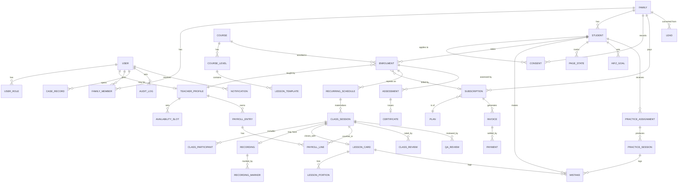
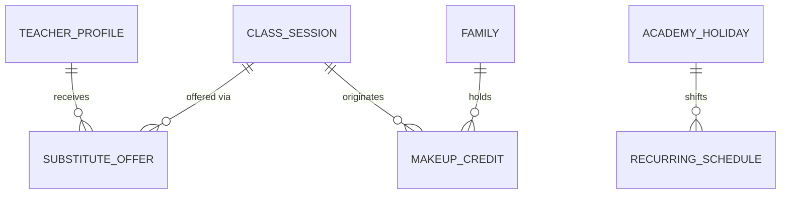
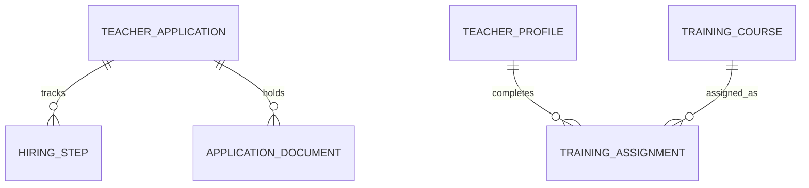

# Hifzoon — Entity Relationship Design (ERD)

Version 1.0 · Database: PostgreSQL 16 · ORM: Prisma · Source: SRS section 7 plus requirements in section 4

Conventions

- Tables and columns are `snake_case`. Primary keys are `id uuid` (v7). Every table has `created_at`, `updated_at` (timestamptz, UTC). Soft-deletable tables add `deleted_at`.
- Enum values are listed under each group and live in `packages/shared`.
- `PK` primary key, `FK` foreign key, `UQ` unique.

---

## 1. Diagram (core entities)

### 1.1 Extended diagrams

Scheduling and substitution:

Hiring pipeline and training:

---

## 2. Tables by module

### 2.1 Identity and access (AUTH)

**user**

| Column             | Type             | Notes                                        |
| ------------------ | ---------------- | -------------------------------------------- |
| id                 | uuid PK          |                                              |
| email              | citext UQ null   | Null for children without email (FR-AUTH-03) |
| password_hash      | text null        | Argon2id; null for OAuth-only                |
| name               | text             |                                              |
| phone              | text null        | Hidden from staff/teachers by API (CR-07)    |
| language           | varchar(5)       | en, ur, ar, fr                               |
| time_zone          | text             | IANA, e.g. `Asia/Karachi`                    |
| status             | enum             | ACTIVE, LOCKED, DISABLED                     |
| failed_login_count | int              | Lockout at 10 (NFR-SEC-04)                   |
| locked_until       | timestamptz null |                                              |
| two_factor_secret  | text null        | Encrypted; required for staff                |
| two_factor_enabled | bool             |                                              |
| last_active_at     | timestamptz      | For session expiry (FR-AUTH-07)              |

**user_role** — `user_id FK`, `role enum` (CHILD_STUDENT, STUDENT, GUARDIAN, TEACHER, EXAMINER, SUPERVISOR, ADMIN, SUPER_ADMIN, SAFEGUARDING_LEAD). UQ `(user_id, role)`. One user can hold many (FR-AUTH-02).

**oauth_account** — `user_id FK`, `provider enum` (GOOGLE, APPLE), `provider_user_id`. UQ `(provider, provider_user_id)`.

**refresh_token** — `user_id FK`, `token_hash`, `device_info`, `expires_at`, `revoked_at`, `last_used_at`.

**password_reset_token** — `user_id FK`, `token_hash`, `expires_at`, `used_at`.

**kids_credential** — `student_id FK UQ`, `type enum` (PIN, PICTURE), `secret_hash`. Set by guardian (FR-AUTH-06).

### 2.2 Families, students and consent

**family** — `id`, `name`, `country`, `currency enum` (USD, GBP, CAD, AUD, AED, PKR), `billing_name`, `billing_address jsonb`, `payment_customer_id text null`.

**family_member** — `family_id FK`, `user_id FK`, `relationship`, `is_primary bool`, `verified_at timestamptz null` (CR-10). UQ `(family_id, user_id)`.

**student** — `id`, `family_id FK`, `user_id FK null` (null until the child has an account), `display_name`, `birth_year int`, `gender enum`, `language`, `time_zone`, `kids_mode bool`, `notes`. Birth year only, not full date (data minimisation).

**consent**

| Column                                                                                              | Type        | Notes                                                                |
| --------------------------------------------------------------------------------------------------- | ----------- | -------------------------------------------------------------------- |
| id                                                                                                  | uuid PK     |                                                                      |
| family_id                                                                                           | FK          |                                                                      |
| student_id                                                                                          | FK null     |                                                                      |
| purpose                                                                                             | enum        | DATA_COLLECTION, CLASS_RECORDING, AI_VOICE, AI_TRAINING, MARKETING   |
| status                                                                                              | enum        | GRANTED, WITHDRAWN                                                   |
| method                                                                                              | enum        | CARD_CHECK, SIGNED_FORM, ID_CHECK, OTHER (verifiable consent method) |
| policy_version                                                                                      | text        | Version of notice shown                                              |
| granted_at, withdrawn_at                                                                            | timestamptz |                                                                      |
| granted_by_user_id                                                                                  | FK          |                                                                      |
| Append-only ledger: withdrawal creates a new row or updates status with history in `consent_event`. |

**data_request** — `family_id`, `student_id null`, `type enum` (EXPORT, DELETE), `status`, `requested_at`, `due_at` (30 days), `completed_at`, `file_url`.

### 2.3 Public website and CMS (ADM)

**cms_post** — `type enum` (BLOG, PRINTABLE, LANDING), `slug UQ`, `locale`, `title`, `body`, `country_code null`, `city null`, `status`, `published_at`, `author_id FK`.

**faq_item** — `locale`, `question`, `answer`, `approved bool`, `sort`. Source for chat assistant.

**chat_conversation** / **chat_message** — `channel enum` (WEB, WHATSAPP), `lead_id FK null`, `handed_over bool`; messages with `role`, `content`, `created_at`.

**teacher_change_request** — `family_id`, `student_id`, `enrolment_id`, `reason`, `status`, `resolved_by FK`, `resolved_at`.

### 2.4 Courses and assessments (CRS)

**course** — `code UQ`, `name`, `type enum` (QAIDA, NAZRA, TAJWEED, HIFZ, MURAJAAH, IJAZAH, ARABIC, TAFSIR, ISLAMIC_STUDIES, NEW_MUSLIM, INTENSIVE), `description`, `active`.

**course_level** — `course_id FK`, `name`, `position int`, `rubric jsonb`, `pass_mark`. UQ `(course_id, position)`.

**lesson_template** — `level_id FK`, `position int`, `title`, `objectives`, `teacher_notes`, `materials jsonb`. UQ `(level_id, position)`.

**enrolment** — `student_id FK`, `course_id FK`, `current_level_id FK`, `current_lesson_position int`, `teacher_id FK`, `subscription_id FK null`, `status enum` (TRIAL, ACTIVE, PAUSED, CANCELLED, COMPLETED), `started_at`, `paused_until`.

**assessment** — `enrolment_id FK`, `level_id FK`, `type enum` (LEVEL, MILESTONE_JUZ, IJAZAH), `examiner_id FK` (must differ from enrolment teacher, enforced in service and CHECK via trigger), `rubric_scores jsonb`, `result enum` (PASS, FAIL, PENDING), `taken_at`.

**certificate** — `assessment_id FK UQ`, `serial_number UQ`, `verification_token UQ`, `student_name`, `teacher_name`, `issued_on`, `pdf_url`. Public verification page by token (FR-CRS-05).

**ijazah_record** (P3) — `enrolment_id`, `sessions jsonb`, `sanad_text`, `issued_by_sheikh`, `issued_on`.

### 2.5 Teachers and hiring (TCH)

**teacher_application** — `applicant_name`, `email`, `phone`, `country`, `qualifications jsonb`, `recitation_audio_url`, `status enum` (SUBMITTED, RECITATION_REVIEW, DEMO_CLASS, ID_CHECK, REFERENCE_CHECK, TRAINING, APPROVED, REJECTED), `user_id FK null` (created on approval).

**hiring_step** — `application_id FK`, `step enum`, `status` (PENDING, PASSED, FAILED), `reviewer_id FK`, `notes`, `completed_at`.

**application_document** — `application_id FK`, `type` (ID, CERTIFICATE, REFERENCE, BACKGROUND_CHECK), `file_url` (encrypted at rest), `verified bool`.

**teacher_profile** — `user_id FK UQ`, `bio`, `photo_url`, `intro_video_url`, `recitation_sample_url`, `qualifications jsonb` (an array of credential entries — type, title, issuer, document URL, `verified`; `verified` is only ever set by an admin approving a staged change, FR-TCH-09), `gender`, `languages text[]`, `subjects text[]`, `age_groups text[]`, `hiring_status enum`, `safeguarding_training_completed_at`, `ready_to_match bool` (true only when all hiring steps and training complete, FR-TCH-02), `pay_rate_id FK`, `tier_id FK null` (admin-assigned, FR-TCH-10 — a teacher cannot set this themselves), `rating_avg numeric`, `pending_profile_changes jsonb null`.

**teacher_tier** — `code` UQ, `name`, `badge_icon null`, `description null`, `sort_order int`, `active bool`. Admin-maintained catalogue (point 4, Oct 2026): drives the badge on a teacher's public card and the tier a `plan` promises (point 5). Seeded with `STANDARD` / `CERTIFIED` / `SENIOR` as placeholders pending sign-off on final naming.

**availability_slot** — `teacher_id FK`, `weekday int`, `start_time time`, `end_time time`, `time_zone`, `effective_from`, `effective_to`. A month-scoped submission (point 1) writes `effective_from`/`effective_to` as the exact first/last day of that month, so it can be replaced without touching other months.

**teacher_leave** — `teacher_id FK`, `date` UQ per teacher, `reason null`. A declared off-day; `findOpenSlots` excludes these dates from bookable search (point 1, Oct 2026).

**teacher_availability_month** — `teacher_id FK`, `month date` UQ per teacher, `submitted_at`. Pure submission-tracking state for the "set once for the whole month" self-service flow; does not itself constrain scheduling.

**training_course** / **training_assignment** — course content and per-teacher progress (`status`, `score`, `completed_at`).

### 2.6 Scheduling and classes (SCH, CLS)

**recurring_schedule** — `enrolment_id FK`, `teacher_id FK`, `rrule text`, `local_start_time time`, `family_time_zone text`, `duration_minutes`, `room_type enum` (ONE_TO_ONE, CIRCLE), `starts_on`, `ends_on null`, `status`.

**class_session**

| Column                                                                                                  | Type        | Notes                                                                                             |
| ------------------------------------------------------------------------------------------------------- | ----------- | ------------------------------------------------------------------------------------------------- |
| id                                                                                                      | uuid PK     |                                                                                                   |
| schedule_id                                                                                             | FK null     | Null for trial or one-off                                                                         |
| teacher_id                                                                                              | FK          |                                                                                                   |
| course_id                                                                                               | FK          |                                                                                                   |
| type                                                                                                    | enum        | TRIAL, REGULAR, CIRCLE, EXAM, MAKEUP                                                              |
| starts_at, ends_at                                                                                      | timestamptz | UTC                                                                                               |
| status                                                                                                  | enum        | SCHEDULED, LIVE, COMPLETED, CANCELLED_FAMILY, CANCELLED_TEACHER, NO_SHOW_STUDENT, NO_SHOW_TEACHER |
| room_id                                                                                                 | text        | Video provider room                                                                               |
| mushaf_layout                                                                                           | enum        | MADANI_15, INDOPAK_13, INDOPAK_16                                                                 |
| tajweed_colours                                                                                         | bool        |                                                                                                   |
| women_only                                                                                              | bool        | FR-CLS-15                                                                                         |
| charged                                                                                                 | bool        | Late cancellation (FR-SCH-04)                                                                     |
| cancelled_at, cancel_reason                                                                             |             |                                                                                                   |
| Constraint: exclusion on `(teacher_id, tstzrange(starts_at, ends_at))` for active statuses (FR-SCH-07). |

**class_participant** — `class_id FK`, `student_id FK null`, `user_id FK`, `role enum` (TEACHER, STUDENT, GUARDIAN_VIEWER, SUPERVISOR), `joined_at`, `left_at`, `minutes_present`. Attendance (FR-CLS-14). Student overlap prevented with a second exclusion constraint on `class_student` (see below).

**class_student** — `class_id FK`, `student_id FK`, `starts_at`, `ends_at` (denormalised for the exclusion constraint). Prevents student double booking.

**makeup_credit** — `family_id FK`, `student_id FK`, `source_class_id FK`, `status` (AVAILABLE, USED, EXPIRED), `expires_at`, `used_class_id FK null`.

**substitute_offer** — `class_id FK`, `teacher_id FK`, `order int`, `status` (OFFERED, ACCEPTED, DECLINED, EXPIRED), `offered_at`, `responded_at`.

**academy_holiday** — `name`, `starts_on`, `ends_on`, `type` (HOLIDAY, RAMADAN_TIMETABLE), `shift_rule jsonb`.

**recording** — `class_id FK UQ`, `storage_key`, `duration_seconds`, `status`, `delete_after timestamptz` (90 days), `retained_for_case_id FK null`.

**recording_marker** — `recording_id FK`, `offset_ms int`, `surah`, `ayah`, `word_index null`, `kind` (PAGE_TURN, HIGHLIGHT, MISTAKE).

**recording_clip** (P2) — `recording_id FK`, `start_ms`, `end_ms` (≤ 60 000), `attached_to_lesson_card_id`.

### 2.7 Lesson records and mistakes (REC)

**lesson_card** — `class_id FK UQ`, `teacher_id FK`, `student_id FK`, `homework`, `parent_note`, `ai_summary_draft`, `summary_approved_at`, `submitted_at`, `shared_at`, `locked_at` (48 h after submit, FR-REC-08).

**lesson_portion** — `lesson_card_id FK`, `kind enum` (SABAQ, SABQI, MANZIL, OTHER), `from_surah`, `from_ayah`, `to_surah`, `to_ayah`, `grade enum` (EXCELLENT, GOOD, NEEDS_WORK, REPEAT).

**mistake**

| Column                                                                                                                                                    | Type             | Notes                                                                            |
| --------------------------------------------------------------------------------------------------------------------------------------------------------- | ---------------- | -------------------------------------------------------------------------------- |
| id                                                                                                                                                        | uuid PK          |                                                                                  |
| student_id                                                                                                                                                | FK               |                                                                                  |
| lesson_card_id                                                                                                                                            | FK null          | Source class                                                                     |
| practice_session_id                                                                                                                                       | FK null          | Source AI practice                                                               |
| class_id                                                                                                                                                  | FK null          | Marked before card exists                                                        |
| surah                                                                                                                                                     | int              | 1–114                                                                            |
| ayah                                                                                                                                                      | int              |                                                                                  |
| word_index                                                                                                                                                | int              |                                                                                  |
| type                                                                                                                                                      | enum             | LETTER_MAKHRAJ, VOWEL_HARAKAH, TAJWEED_RULE, SKIPPED_WORD, ADDED_WORD, STOP_WAQF |
| tajweed_rule                                                                                                                                              | text null        |                                                                                  |
| source                                                                                                                                                    | enum             | CLASS, AI                                                                        |
| confirmed                                                                                                                                                 | bool             | AI flags need teacher confirm/dismiss                                            |
| dismissed_at                                                                                                                                              | timestamptz null | Kept for model tuning                                                            |
| ai_confidence                                                                                                                                             | numeric null     |                                                                                  |
| occurred_at                                                                                                                                               | timestamptz      |                                                                                  |
| Indexes: `(student_id, surah, ayah)`, `(lesson_card_id)`. CHECK that exactly one of `lesson_card_id`/`practice_session_id`/`class_id` context is present. |

**lesson_edit_log** — `lesson_card_id`, `editor_id`, `before jsonb`, `after jsonb`, `edited_at` (supervisor edits after lock, FR-REC-08).

### 2.8 Hifz engine (HFZ)

**page_state** — `student_id FK`, `page_number int CHECK 1..604`, `state enum` (NOT_STARTED, IN_PROGRESS, FRAGILE, SOLID), `mistake_count_recent int`, `last_revised_at`, `next_due_at`, `interval_days int`. PK `(student_id, page_number)`.

**hifz_rule_config** — `version`, `rules jsonb` (thresholds for grade/mistake → state), `updated_by` (academic head configurable, FR-HFZ-02).

**daily_plan** — `student_id FK`, `date`, `sabaq jsonb`, `sabqi jsonb`, `manzil jsonb`, `status` (PROPOSED, ACCEPTED, CHANGED), `changed_by`.

**hifz_goal** — `student_id`, `target_description`, `target_from_page`, `target_to_page`, `due_on`, `lines_per_day_needed`, `status`, `behind_since null`.

**hifz_alert** — `student_id`, `teacher_id`, `type` (BEHIND_GOAL, MANZIL_DROP), `created_at`, `acknowledged_at`.

### 2.9 AI recitation coach (AIC, P3)

**practice_assignment** — `student_id`, `teacher_id`, `from_surah`, `from_ayah`, `to_surah`, `to_ayah`, `mode enum` (READING, MEMORISATION), `target_minutes`, `due_on`, `status`.

**practice_session** — `assignment_id FK`, `student_id`, `started_at`, `ended_at`, `minutes`, `words_recited`, `reveals_count`, `audio_key null`, `audio_delete_after` (30 days), `result_summary jsonb`.

**voice_search_log** (P3) — optional, no audio stored.

### 2.10 Billing and payroll (BIL)

**plan** — `code UQ`, `name`, `classes_per_week`, `class_minutes`, `room_type`, `billing_period` (MONTHLY, QUARTERLY, HALF_YEARLY), `active`, `tier_id FK null` (point 5, Oct 2026 — the teacher tier this plan promises; the public listing sells this and omits `plan_price`, which checkout still reads unchanged via an authenticated `priceFor` call, FR-BIL-09).
**plan_price** — `plan_id FK`, `currency`, `amount_minor int`. UQ `(plan_id, currency)`.
**discount_rule** — `type` (SIBLING, PREPAID, REFERRAL, CODE), `config jsonb`, `active`.
**subscription** — `family_id FK`, `plan_id FK`, `currency`, `status` (TRIALING, ACTIVE, PAST_DUE, PAUSED, CANCELLED), `provider_subscription_id`, `current_period_start/end`, `paused_until`, `cancel_at_period_end`.
**invoice** — `family_id`, `subscription_id`, `number UQ`, `currency`, `subtotal_minor`, `discount_minor`, `total_minor`, `status` (DRAFT, OPEN, PAID, FAILED, REFUNDED, VOID), `due_at`, `paid_at`, `pdf_url`.
**payment** — `invoice_id FK`, `provider enum` (STRIPE, PAYPAL, OTHER), `provider_payment_id UQ`, `method`, `amount_minor`, `status`, `attempt int`, `next_retry_at`, `failure_reason`.
**refund** — `payment_id FK`, `amount_minor`, `reason`, `issued_by FK`.
**class_credit** — `family_id`, `amount_classes`, `reason`, `issued_by`.
**sponsorship** (P3) — `donor_user_id`, `student_id null`, `status`, `started_on`.

**pay_rate** — `name`, `currency`, `rate_per_class_minor`, `class_type`, `effective_from`.
**payroll_period** — `starts_on`, `ends_on`, `status` (OPEN, CALCULATED, EXPORTED, PAID).
**payroll_entry** — `period_id FK`, `teacher_id FK`, `gross_minor`, `deductions_minor`, `bonuses_minor`, `net_minor`, `status`, `paid_at`, `payout_reference`. UQ `(period_id, teacher_id)`.
**payroll_line** — `entry_id FK`, `class_id FK null`, `kind` (CLASS, DEDUCTION_LATE, DEDUCTION_MISSED, BONUS), `amount_minor`, `note`.

### 2.11 Quality, cases and safeguarding (QA)

**class_review** — `class_id FK`, `family_user_id FK`, `stars int 1..5`, `comment`. UQ `(class_id, family_user_id)`.
**qa_rubric** — `name`, `criteria jsonb`, `active`.
**qa_review** — `class_id FK`, `supervisor_id FK`, `rubric_id FK`, `scores jsonb`, `feedback`, `teacher_reply`, `reviewed_at`, `source` (RANDOM_SAMPLE, MANUAL).
**qa_sample** — `teacher_id`, `period`, `class_id`.
**case_record** — `type enum` (COMPLAINT, SAFEGUARDING), `status`, `owner_id FK`, `opened_by FK`, `subject_user_id`, `class_id null`, `summary`, `due_at`, `alerted_at`, `closed_at`. Row-level security: SAFEGUARDING visible only to SAFEGUARDING_LEAD and SUPER_ADMIN.
**case_note** — `case_id`, `author_id`, `note`, `created_at`.

### 2.12 CRM and operations (OPS)

**lead** — `source`, `status enum` (NEW, TRIAL_BOOKED, TRIAL_DONE, WON, LOST), `owner_id FK`, `contact_name`, `email`, `phone`, `country`, `region`, `city`, `postcode`, `lat`, `lng` (M-GEO-01 — marketing area roll-ups), `child_age`, `course_interest`, `family_id FK null`, `trial_class_id FK null`, `lost_reason`.
**task** — `lead_id FK null`, `type` (NO_SHOW_FOLLOWUP, TRIAL_NOT_CONVERTED, OTHER), `assignee_id`, `due_at`, `status`.
**trial_outcome** — `class_id FK` (the triggering class; no longer unique — a trial is up to 3 sessions/week), `enrolment_id FK UQ` (nullable; one outcome per trial package), `placement_level_id FK`, `recommended_plan_id FK`, `notes`, `subscribe_token`.
**app_setting** — `key UQ`, `value jsonb`, `updated_by` (prices, cancellation notice period, roles — FR-OPS-05).
**role_permission** — `role`, `permission`, for configurable permissions without code changes.
**audit_log** — `actor_id`, `action`, `target_type`, `target_id`, `before jsonb`, `after jsonb`, `ip`, `at`. Append-only (no UPDATE/DELETE grants). Retained 3 years.

### 2.13 Messaging, notifications and engagement

**message_thread** — `family_id`, `teacher_id`, `student_id null`. **message** — `thread_id`, `sender_id`, `body`, `created_at`, `read_at`. Visible to supervisors (FR-PAR-07).
**notification_preference** — `user_id FK UQ`, `email bool`, `whatsapp bool`, `push bool`, `quiet_from`, `quiet_to`, `language`.
**notification** — `user_id`, `type`, `channel`, `payload jsonb`, `status` (QUEUED, SENT, FAILED), `scheduled_for`, `sent_at`.
**device_token** (P2) — `user_id`, `platform`, `token`.
**badge** / **student_badge**, **streak**, **sticker_award**, **referral** (`code UQ`, `referrer_family_id`, `new_family_id`, `reward_applied`), **personal_goal**, **ayah_note**, **vocab_card** (all P2–P3, ENG).

### 2.14 Content cache

**content_cache** — `key UQ` (e.g. `mushaf:madani:page:12`), `value jsonb`, `fetched_at`, `expires_at` (≤ 7 days under the Quran Foundation terms, CR-11).
**mushaf_layout_ref** — optional table mapping `(layout, page)` to `(surah, ayah_from, ayah_to)` if layout data is stored locally under licence.

---

## 3. Key constraints and rules

| Rule                            | Implementation                                                                              | SRS               |
| ------------------------------- | ------------------------------------------------------------------------------------------- | ----------------- |
| No teacher double-booking       | GiST exclusion constraint on class_session                                                  | FR-SCH-07         |
| No student double-booking       | GiST exclusion constraint on class_student                                                  | FR-SCH-07         |
| Examiner ≠ own teacher          | Service check + DB trigger on assessment                                                    | FR-CRS-04         |
| Teacher only matched if cleared | `ready_to_match` computed from hiring steps and training; matching query filters on it      | FR-TCH-02         |
| Lesson card locks after 48 h    | `locked_at`; updates after lock allowed only for SUPERVISOR and logged to `lesson_edit_log` | FR-REC-08         |
| Page number range               | CHECK 1..604                                                                                | FR-HFZ-01         |
| Under-13 data requires consent  | Application guard checks `consent` before inserts for the student                           | FR-AUTH-04, CR-01 |
| Recording only with consent     | `classroom` checks CLASS_RECORDING consent for every student                                | FR-CLS-12         |
| AI coach needs voice consent    | Guard on practice endpoints                                                                 | FR-AIC-09         |
| Safeguarding case privacy       | Row-level security policy                                                                   | FR-QA-05          |
| Audit log append-only           | DB role without UPDATE/DELETE                                                               | FR-OPS-06         |
| Money as integers               | `amount_minor` in smallest currency unit                                                    | BIL               |

## 4. Retention jobs (SRS section 7)

| Data                   | Rule                                                     | Job                          |
| ---------------------- | -------------------------------------------------------- | ---------------------------- |
| recording              | delete 90 days after class unless retained for a case    | nightly, uses `delete_after` |
| practice_session audio | delete audio 30 days; keep derived results               | nightly                      |
| Learning record        | while active + 2 years unless guardian requests deletion | monthly sweep                |
| Financial records      | 6–7 years (by operating country)                         | no auto-delete; archive      |
| lead (never enrolled)  | 12 months                                                | monthly                      |
| audit_log              | 3 years                                                  | monthly                      |

## 5. Enumerations (summary)

- `role`: CHILD_STUDENT, STUDENT, GUARDIAN, TEACHER, EXAMINER, SUPERVISOR, ADMIN, SUPER_ADMIN, SAFEGUARDING_LEAD
- `page_state`: NOT_STARTED, IN_PROGRESS, FRAGILE, SOLID
- `mistake_type`: LETTER_MAKHRAJ, VOWEL_HARAKAH, TAJWEED_RULE, SKIPPED_WORD, ADDED_WORD, STOP_WAQF
- `grade`: EXCELLENT, GOOD, NEEDS_WORK, REPEAT
- `portion_kind`: SABAQ, SABQI, MANZIL
- `mushaf_layout`: MADANI_15, INDOPAK_13, INDOPAK_16
- `currency`: USD, GBP, CAD, AUD, AED, PKR
- `lead_status`: NEW, TRIAL_BOOKED, TRIAL_DONE, WON, LOST

## 6. Seed data (for development and tests)

- Roles and permissions, one user per role.
- Courses from FR-CRS-01 with 2–3 levels and sample lessons.
- Plans and prices for the 6 currencies (placeholder values until pricing is decided).
- `hifz_rule_config` v1 defaults.
- Demo teacher availability and a sample family with two children (one under 13 with consents).

## 7. Open modelling questions

1. Will circles allow mixed gender children? Affects `women_only` and class participant rules.
2. Whether Mushaf layout data is stored locally or fetched live depends on the Quran licence; schema supports both through `content_cache` and `mushaf_layout_ref`.
3. Payment provider choice may add provider-specific columns; they are isolated in `payment` and `subscription` via `provider_*` fields.
